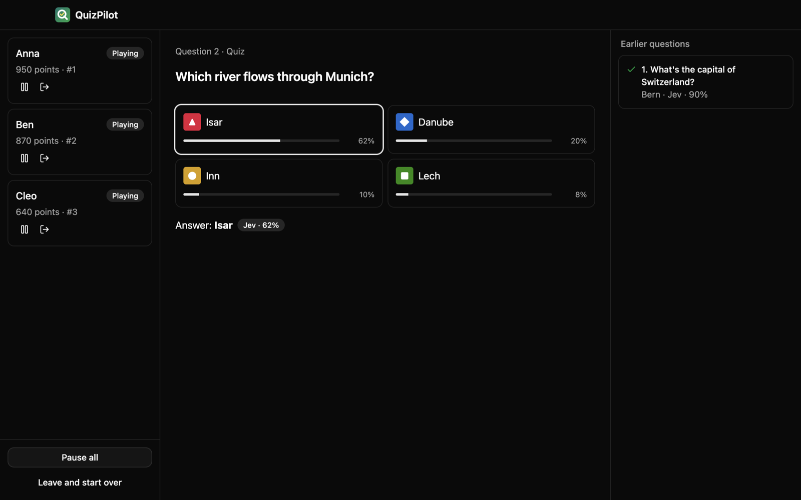

# QuizPilot

Joins a Kahoot game with up to five bots that answer for you. Questions go to
[Jev](https://typesafe.ai) from TypeSafe and, when Jev isn't sure, optionally to Claude,
OpenAI or Gemini.



## Download

Get the installer for your system from the
[latest release](https://github.com/rayakame/quizpilot/releases/latest). The builds aren't
signed, so your system will complain the first time:

- **macOS:** open the dmg and drag QuizPilot to Applications. On first start macOS says it
  can't check the app. Go to System Settings → Privacy & Security and click "Open Anyway".
  Or run `xattr -dr com.apple.quarantine /Applications/QuizPilot.app`.
- **Windows:** SmartScreen shows "Windows protected your PC". Click "More info", then
  "Run anyway".
- **Linux:** make the AppImage executable (`chmod +x QuizPilot-*.AppImage`) and start it.
  Some distros need `libfuse2` for that. If it closes right away on Ubuntu 24.04 or newer,
  start it with `--no-sandbox`.

Windows and Linux update themselves. On macOS QuizPilot tells you when a new version is out.

## What you need

- A TypeSafe API key for Jev.
- Optional: a key from Anthropic, OpenAI or Google for the backup AI.

## Privacy

Your keys stay on your computer and only go to the service they belong to. Questions and
their pictures are sent to TypeSafe and, if you set one up, to the backup AI. Played games
are saved locally and can be deleted in the settings. QuizPilot asks GitHub whether there's
a new version. There is no telemetry.

## Kahoot

Bots in someone else's game can break Kahoot's terms of use and spoil the fun for others.
Use QuizPilot where the host is fine with it. This project isn't affiliated with Kahoot!,
TypeSafe, Anthropic, OpenAI or Google.

## Development

You need Node 24 and pnpm.

```sh
pnpm install
pnpm dev      # start the app
pnpm test     # also: pnpm lint, pnpm typecheck
pnpm dist     # build installers into dist/
```

To release, run the release workflow on GitHub (Actions → release → Run workflow) with the
new version. It runs the checks, tags the commit, builds the installers for all three systems
and puts them into a release, as a draft unless you tick "publish". Pushing a tag like
`v0.2.0` works too.

## License

[MIT](LICENSE)
